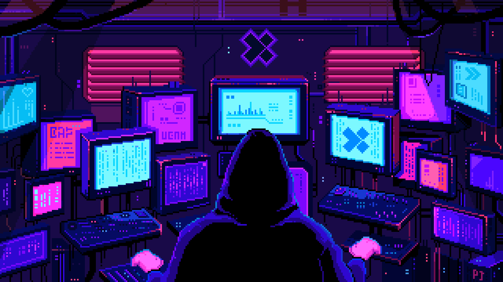

 

---

 

---

## `WHOAMI` — About Me

I'm **Rithish Abinav AC**, a B.E. Cybersecurity graduate and Offensive Security Engineer passionate about web application security, vulnerability research, and autonomous security tool development.

I also contributed to **Project Hellhound / Hellhound Pentest**, a multi-agent web penetration testing platform built around specialized agents and adaptive vulnerability discovery.

---

## `PROJECTS` — Security Tools & Research

### Standalone Tools & Agents

- **Agent389 — LDAP Agent** `ACTIVE`
  Tests applications for LDAP injection vulnerabilities through automated payload testing and verification.

- **GateForge — SSRF Agent** `ACTIVE`
  Detects SSRF vulnerabilities, internal network exposure, and cloud metadata risks.

- **CrossForge — CSRF Agent** `IN DEVELOPMENT`
  Tests CSRF vulnerabilities through token validation and cross-origin request analysis.
  
- **Spectre — DNS Tunneling Detection** `ACTIVE`
  Detects suspicious DNS traffic using entropy analysis and anomaly detection.

- **HellCorp — VulnLab** `ACTIVE`
  An enterprise-style vulnerable lab for practising web exploitation and attack-chain scenarios.

---
### Project Hellhound — Contributions

Contributed to the Hellhound security-tool ecosystem and its related development work.

| Tool / Module | Status |
|---|---|
| Tech-Profile | Active |
| Fuzz-Hunter | Active |
| WAF Buster | Active |
| Transport-Auditor | Active |
| Surface-Auditor | Active |

---

## `TECHNICAL FOCUS` — Technical Areas

**OFFENSIVE SECURITY & WEB APPLICATION TESTING**

**AUTOMATION & DEVELOPMENT**

**SECURITY TOOLS**

**AI, HARDWARE & WIRELESS SECURITY**

---

## `CONNECT` — Let's Connect

I'm interested in offensive security research, vulnerability discovery, security-tool engineering and collaboration on responsible security projects.

- **Email:** [rithish81abinav@gmail.com](mailto:rithish81abinav@gmail.com)
- **GitHub:** [github.com/Abinav3ac](https://github.com/Abinav3ac)
- **LinkedIn:** [linkedin.com/in/rithish06abinav](https://www.linkedin.com/in/rithish06abinav/)
- **TryHackMe:** [tryhackme.com/p/Alph4rc](https://tryhackme.com/p/Alph4rc)

---

 

### `Research the attack surface. Engineer the detection. Validate the evidence.`

